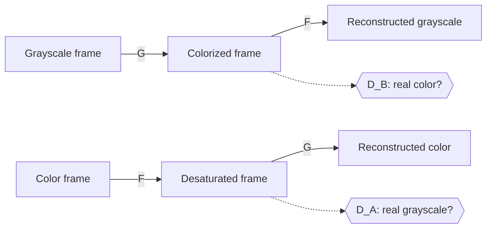

# Cartoon Colorization with CycleGAN

Turns black-and-white cartoon frames into color with a CycleGAN trained on **unpaired** data. It needs no matched grayscale/color pairs, just a folder of color cartoon frames.

<!-- After training, replace this with your own results grid:

-->

## How it works



Two generators learn opposite mappings: **G** colors grayscale frames and **F** removes color. Two discriminators judge whether an image looks like a real frame from its domain. Training balances three losses:

| Loss | What it enforces | Weight |
|---|---|---|
| Adversarial (least-squares) | Colorized frames look like real color cartoons | 1 |
| Cycle consistency (L1) | Gray → color → gray returns the original, so G can't invent a different scene | 10 |
| Identity (L1) | G leaves an already-colored frame unchanged, which keeps palettes stable | 5 |

**Getting unpaired data from paired data.** The color frames are shuffled and split in half. One half is converted to grayscale (domain A) and the other stays in color (domain B). The model never sees the true colors of an A frame, so it learns colorization from the overall look of the show.

**Architecture.** ResNet generator (2 downsampling layers, 9 residual blocks, 2 upsampling layers, instance norm) and a 70×70 PatchGAN discriminator, following [Zhu et al., 2017](https://arxiv.org/abs/1703.10593). Training uses a 50-image history buffer for the discriminators and a learning rate that stays constant, then decays linearly to zero.

See [docs/HOW_IT_WORKS.md](docs/HOW_IT_WORKS.md) for a step-by-step walkthrough of the code.

## Quick start

**Train on Colab (free GPU).** Open [`notebooks/train_colab.ipynb`](notebooks/train_colab.ipynb) in Google Colab and choose Run all. By default it trains on six public-domain Max Fleischer *Superman* shorts (1941–43) from the [Internet Archive](https://archive.org/details/fleischer-superman) and holds out a seventh for testing.

**Or locally:**

```bash
git clone https://github.com/ArunaSamhitha/Cartoon-Colorization-Using-CycleGAN.git
cd Cartoon-Colorization-Using-CycleGAN
pip install -r requirements.txt

# 1. Build a frame dataset from cartoon videos (or use any folder of color images)
python scripts/extract_frames.py --videos clips/ --out data/frames --every 12

# 2. Train
python train.py --frames data/frames --out runs/exp1 --epochs 100 --decay-start 50

# 3. Score it on frames from an episode it never saw, against their true colors
python scripts/extract_frames.py --videos heldout_episode.mp4 --out data/heldout --every 24
python scripts/evaluate.py --frames data/heldout --train-frames data/frames \
    --model full=runs/exp1/checkpoints/colorizer.pt --out results/eval

# 4. Colorize an image, a folder, or a whole video
python colorize.py --ckpt runs/exp1/checkpoints/colorizer.pt --input bw_clip.mp4 --output color_clip.mp4
```

During training, `runs/exp1/samples/` gets a grid each epoch with the grayscale input, the colorized output and the reconstruction in rows, so you can watch it learn. Per-epoch losses are written to `history.json`.

## Project layout

```
cyclegan/
  models.py       Generator (ResNet) and PatchGAN discriminator
  data.py         Unpaired grayscale/color dataset from one folder of frames
  utils.py        Image history buffer, LR schedule, sample grids
train.py          Training loop with mixed precision, checkpointing and resume
colorize.py       Inference for an image, a folder or a video, with FPS measurement
scripts/
  extract_frames.py   Sample frames from cartoon videos
  make_results.py     Results grid on held-out frames
  evaluate.py         PSNR, SSIM, ΔE2000, LPIPS, FID and colorfulness vs. ground truth, with baselines
  benchmark.py        Inference throughput across batch sizes and precisions
  plot_history.py     Loss curves from one or more runs
notebooks/
  train_colab.ipynb   End-to-end training on a free Colab GPU
```

## Results

<!-- Paste results.md from the notebook's evaluation step here, plus assets/loss_curves.png -->
_Coming soon._ The Colab notebook trains the model and an identity-loss ablation, then scores both against two baselines (`grayscale`, and `mean_tint`: the training set's average color over the input) on a held-out episode, with 95% bootstrap confidence intervals.

## Limitations

- Colors are plausible for the show's style, not "correct". The model can't know a character's original colors if it never saw them.
- CycleGAN changes color and texture well but not shape. That suits colorization, since the line art stays the same.
- Training at 128 px with `--n-blocks 6` takes about 4.7 minutes per epoch on a Colab T4 (about 2 hours for the notebook default of 25 epochs). 256 px is roughly 4× slower.

## License

MIT
